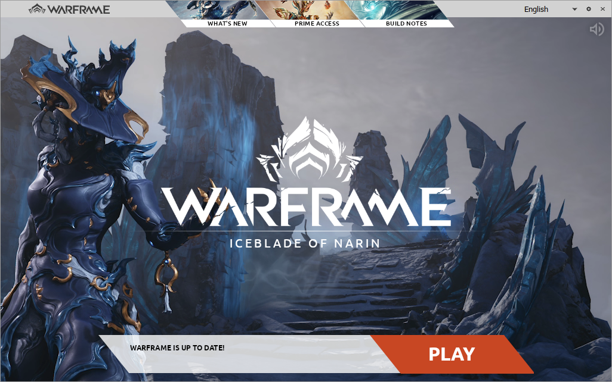

# Wrapper no oficial de Warframe para macOS

Juega la versión de Windows de Warframe en una Mac con Apple Silicon, gratis, usando
un motor de Wine compilado del código abierto de CrossOver de CodeWeavers.

> **No oficial.** Este proyecto no está afiliado, respaldado ni soportado por
> Digital Extremes. Warframe es una marca de Digital Extremes Ltd. Jugar con Wine no
> tiene soporte oficial; úsalo bajo tu propio riesgo.

[Read in English](README.md)



*El launcher de Windows en un Mac mini M4 (macOS 15.7.7). Arte © Digital Extremes.*

> **Estado: en desarrollo, sin versión publicada.** La instalación completa funciona
> en una M2 Pro (macOS 27.2) y una Mac mini M4 (macOS 15.7.7). En la M4 el juego inicia
> sesión, carga el orbitador y completa misiones con DXMT a 60 FPS estables en calidad
> media. D3DMetal todavía no se ha probado jugando. Ver
> [docs/TESTING.md](docs/TESTING.md).

> **Hecho con IA.** Los scripts y la documentación de este repositorio se escribieron
> con ayuda de un asistente de programación con IA ([Claude Code](https://claude.com/claude-code)
> de Anthropic), dirigido y probado en Macs reales por el mantenedor. Revisa los scripts
> antes de ejecutarlos, como con cualquier código de internet.

## Qué hace

Warframe no tiene versión nativa para Mac. Este proyecto contiene **solo scripts**.
Arman un `Warframe.app` en tu Mac con piezas descargadas de sus fuentes oficiales:

| Pieza | De dónde sale |
|---|---|
| Plantilla del wrapper (la app, DXMT, D3DMetal, MoltenVK) | Releases de [Sikarugir](https://github.com/Sikarugir-App/Sikarugir) en GitHub, versión fija y verificada con checksum |
| Motor de Wine `WS12WineCX24.0.7_7` (compilado del código abierto de CrossOver 24.0.7) | Releases de motores de Sikarugir, versión fija y verificada con checksum |
| Instalador y juego de Warframe | Digital Extremes (`content.warframe.com`) y su launcher oficial |

En este repositorio no se guarda nada de Digital Extremes, Apple ni Sikarugir.

## Requisitos

- Mac con Apple Silicon (M1 o posterior). En Intel no está probado.
- macOS 14.6 o posterior.
- Rosetta 2: `softwareupdate --install-rosetta --agree-to-license`
- Unos 60 GB libres para el juego completo.

## Instalar

```bash
git clone https://github.com/Javiergptrd/warframe-macos-wrapper.git
cd warframe-macos-wrapper
./install.sh
```

Después abre **Warframe.app** (Finder → tu carpeta de inicio → Aplicaciones → Sikarugir),
acepta la carpeta que propone el launcher y deja que descargue el juego.

Opciones útiles (`./install.sh --help` muestra todas):

| Opción | Para qué |
|---|---|
| `--msi ~/Downloads/Warframe.msi` | Usar un instalador que ya descargaste |
| `--renderer d3dmetal` | Empezar con D3DMetal de Apple en vez de DXMT |
| `--name "Warframe 2"` | Crear una segunda copia |
| `--launch` | Abrir la app al terminar |

## Traductores de gráficos

| Opción | DirectX | Notas |
|---|---|---|
| **DXMT** (por defecto) | 11 | Código abierto. Elige **DirectX 11** en la configuración del launcher. Puede trabarse un poco mientras compila shaders. |
| **D3DMetal** | 11 y 12 | El traductor de Apple, incluido en la plantilla de Sikarugir. DirectX 12 guarda caché de shaders. |

```bash
tools/renderer.sh            # ver cuál está activo
tools/renderer.sh d3dmetal   # cambiar (aplica al abrir la app de nuevo)
tools/renderer.sh dxmt
```

## Estado, registros y desinstalar

```bash
tools/status.sh              # motor, gráficos, tamaño descargado, últimas líneas del launcher
tools/watch-log.sh           # sigue el registro del juego en vivo mientras juegas (--all para ver todo);
                             # también guarda el registro completo, que el juego borra al iniciar
./uninstall.sh               # manda Warframe.app (con el juego dentro) a la Papelera
./uninstall.sh --delete      # lo borra para siempre
```

## Programas de limpieza

Los datos del juego viven **dentro** de `Warframe.app`, en una carpeta llamada
`Cache.Windows`. Es el juego, no caché. Wine además usa archivos en la carpeta temporal
del sistema (`winetemp-*`, `.wine-*`) mientras corre. Los limpiadores no deben tocarlos.
Si usas [Mole](https://mole.fit) con lista de exclusiones propia, `install.sh` agrega
las exclusiones solo.

## Cómo funciona

Lee [docs/HOW-IT-WORKS.md](docs/HOW-IT-WORKS.md) para el proceso completo y
[docs/TESTING.md](docs/TESTING.md) para la lista de pruebas.

## Créditos y licencias

Los scripts de este repositorio usan licencia MIT ([LICENSE](LICENSE)). Los componentes
de terceros se descargan de sus autores al instalar; ver [THIRD_PARTY.md](THIRD_PARTY.md).

Este proyecto existe gracias al trabajo de otros:

- **[Sikarugir](https://github.com/Sikarugir-App)** (Gcenx y colaboradores), por la
  plantilla del wrapper y los motores de Wine en los que se basa este proyecto.
- **[CodeWeavers](https://www.codeweavers.com/)**, por publicar el código de CrossOver,
  y el **[proyecto Wine](https://www.winehq.org/)**.
- **[DXMT](https://github.com/3Shain/dxmt)** de 3Shain, el traductor libre de DirectX 11 a Metal.
- **Apple**, por D3DMetal (Game Porting Toolkit), y el **Khronos Group** por MoltenVK.
- **[Mole](https://github.com/tw93/Mole)** de tw93, cuya lista de exclusiones respeta el instalador.
- **Digital Extremes**, por Warframe.
- **[Claude Code](https://claude.com/claude-code)** de Anthropic, el asistente de IA usado para escribir los scripts y la documentación.
