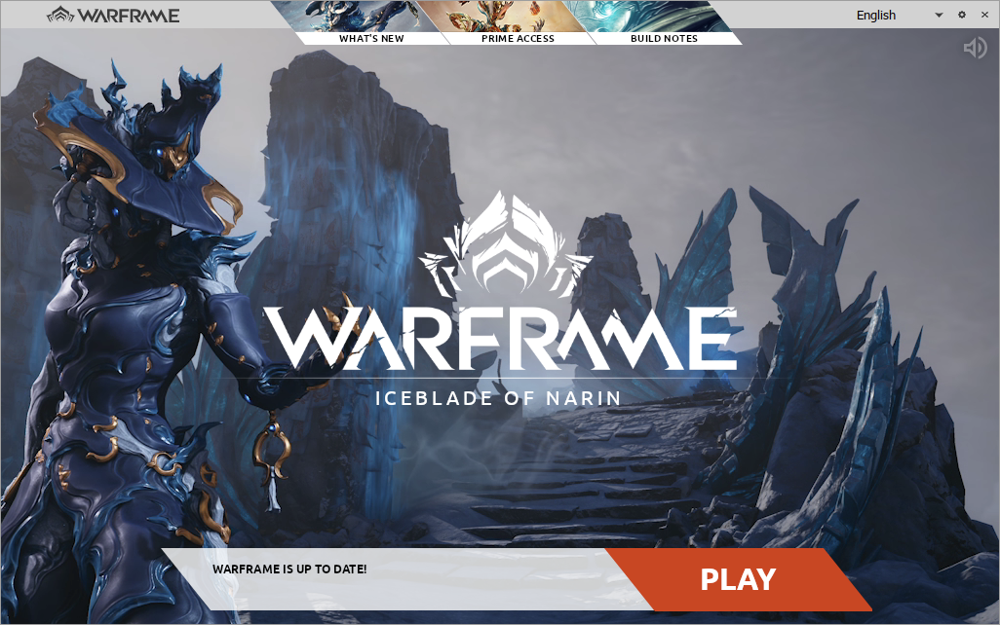

# Unofficial Warframe Wrapper for macOS

Play the Windows version of Warframe on an Apple Silicon Mac, for free, using a Wine
engine built from CodeWeavers' open-source CrossOver code.

> **Unofficial.** This project is not affiliated with, endorsed by, or supported by
> Digital Extremes. Warframe is a trademark of Digital Extremes Ltd. Running the game
> through Wine is not officially supported; use it at your own risk.

[Leer en español](README.es.md)



*The Windows launcher running on a Mac mini M4 (macOS 15.7.7). Artwork © Digital Extremes.*

> **Status: work in progress, not released.** The full install works on an M2 Pro
> (macOS 27.2) and an M4 Mac mini (macOS 15.7.7). On the M4, the game logs in, loads
> the orbiter and completes missions with DXMT at a steady 60 FPS on Medium settings.
> D3DMetal is not play-tested yet. See [docs/TESTING.md](docs/TESTING.md).

> **Made with AI.** The scripts and documentation in this repository were written
> with the help of an AI coding assistant ([Claude Code](https://claude.com/claude-code)
> by Anthropic), directed and tested on real Macs by the maintainer. Review the scripts
> before running them, as you would with any code from the internet.

## What it does

Warframe has no native macOS client. This project contains **only scripts**. They
build a `Warframe.app` on your Mac from pieces downloaded from their official sources:

| Piece | Source |
|---|---|
| Wrapper template (the `.app` shell, DXMT, D3DMetal, MoltenVK) | [Sikarugir](https://github.com/Sikarugir-App/Sikarugir) GitHub releases, pinned and checksum-verified |
| Wine engine `WS12WineCX24.0.7_7` (built from CrossOver 24.0.7 open source) | Sikarugir Engines releases, pinned and checksum-verified |
| Warframe installer and game | Digital Extremes (`content.warframe.com`) and the official launcher |

Nothing from Digital Extremes, Apple or Sikarugir is stored in this repository.

## Requirements

- Mac with Apple Silicon (M1 or later). Intel is untested.
- macOS 14.6 or later.
- Rosetta 2: `softwareupdate --install-rosetta --agree-to-license`
- About 60 GB of free disk space for the full game.

## Install

```bash
git clone https://github.com/Javiergptrd/warframe-macos-wrapper.git
cd warframe-macos-wrapper
./install.sh
```

Then open **Warframe.app** (Finder → your home folder → Applications → Sikarugir),
accept the launcher's default install folder, and let it download the game.

Useful options (`./install.sh --help` lists all):

| Option | Purpose |
|---|---|
| `--msi ~/Downloads/Warframe.msi` | Use an installer you already downloaded |
| `--renderer d3dmetal` | Start with Apple's D3DMetal instead of DXMT |
| `--name "Warframe 2"` | Build a second copy |
| `--launch` | Open the app when done |

## Graphics backends

| Backend | DirectX | Notes |
|---|---|---|
| **DXMT** (default) | 11 | Open source. Select **DirectX 11** in the launcher settings. Some stutter while shaders compile. |
| **D3DMetal** | 11 and 12 | Apple's translator, bundled in Sikarugir's template. DirectX 12 keeps a shader cache. |

```bash
tools/renderer.sh            # show the current backend
tools/renderer.sh d3dmetal   # switch (applies the next time the app opens)
tools/renderer.sh dxmt
```

## Status, logs and uninstall

```bash
tools/status.sh              # engine, backend, download size, last launcher log lines
tools/watch-log.sh           # follow the game's log live while playing (--all for every line);
                             # also saves the full log, which the game overwrites on each launch
./uninstall.sh               # moves Warframe.app (and the game data inside it) to the Trash
./uninstall.sh --delete      # deletes it permanently instead
```

## Cleaning tools

The game data lives **inside** `Warframe.app`, in a folder named `Cache.Windows`.
It is the game, not a cache. Wine also keeps running files in the system temp folder
(`winetemp-*`, `.wine-*`). Cleaners must not touch these while the app is open.
If you use [Mole](https://mole.fit) with a custom whitelist, `install.sh` adds the
right exclusions automatically.

## How it works

See [docs/HOW-IT-WORKS.md](docs/HOW-IT-WORKS.md) for the full process and the layout
inside the app, and [docs/TESTING.md](docs/TESTING.md) for the test checklist.

## Credits and licenses

The scripts in this repository are MIT licensed ([LICENSE](LICENSE)). Third-party
components are downloaded from their authors at install time; see
[THIRD_PARTY.md](THIRD_PARTY.md).

This project only exists thanks to the work of others:

- **[Sikarugir](https://github.com/Sikarugir-App)** (Gcenx and contributors), for the
  wrapper template and the Wine engines this project builds on.
- **[CodeWeavers](https://www.codeweavers.com/)**, for publishing the CrossOver source
  code, and the **[Wine project](https://www.winehq.org/)**.
- **[DXMT](https://github.com/3Shain/dxmt)** by 3Shain, the open-source DirectX 11 → Metal translator.
- **Apple**, for D3DMetal (Game Porting Toolkit), and the **Khronos Group** for MoltenVK.
- **[Mole](https://github.com/tw93/Mole)** by tw93, whose cleanup whitelist the installer respects.
- **Digital Extremes**, for Warframe.
- **[Claude Code](https://claude.com/claude-code)** by Anthropic, the AI assistant used to write the scripts and docs.
